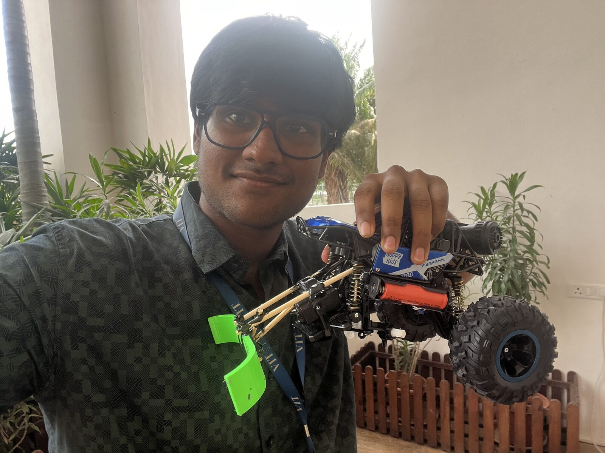
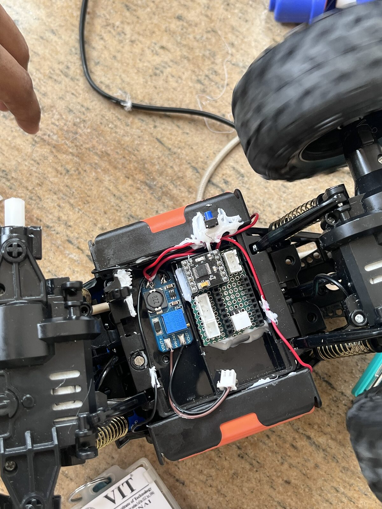
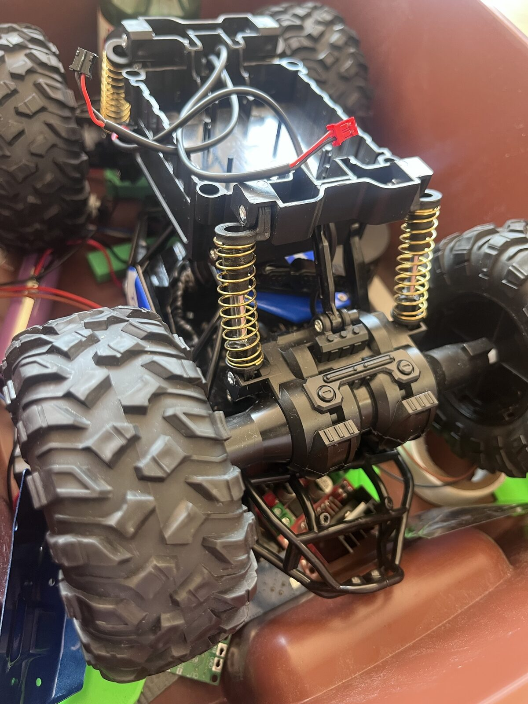
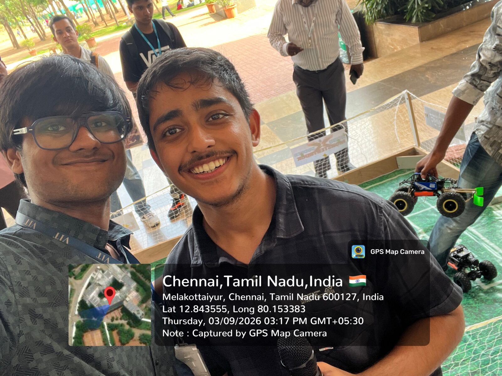

# Robo Soccer Car – technoVIT'26

An RC car converted for the **robo soccer** event at technoVIT'26, VIT Chennai (September 2026).

▶ **[Watch a match](match.mp4)**

## My part
- **Electronics:** I built the onboard electronics, a boost converter and a motor-driver board on perfboard, powered by an 18650 cell.
- **Scoop:** I designed and 3D-printed the green front scoop that controls the ball.

| Electronics | Chassis |
|---|---|
|  |  |

